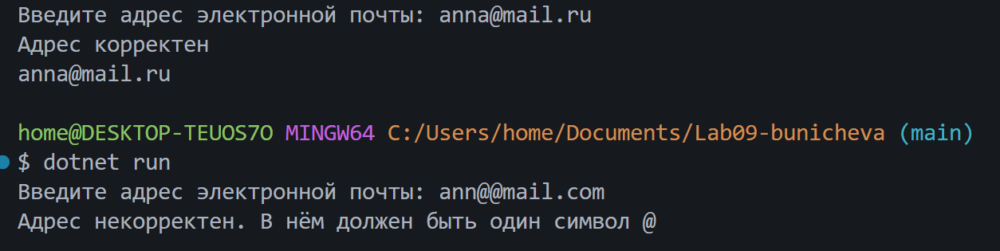
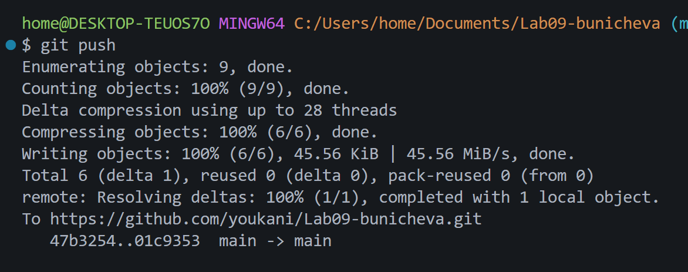

# Практическая работа №9. Строки и обработка текста

**ФИО:** Буничева Алёна Алексеевна

**Группа:** ИСП-242

**Дата:** 28.10.2026

## Что изучено
- Строки в C# нельзя изменить «по месту». Методы `ToUpper()`, `ToLower()` или `Replace()`, не меняют исходный текст, а возвращают новую строку. Чтобы сохранить результат, его обязательно нужно записать в переменную.
- К любому символу строки можно обратиться напрямую по его индексу через квадратные скобки.
- Методы проверки и преобразования текста: `Contains`, `StartsWith` и `EndsWith` подходят для  проверки на корректность, а метод `Substring` позволяет вырезать части текста.

